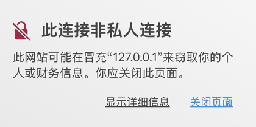
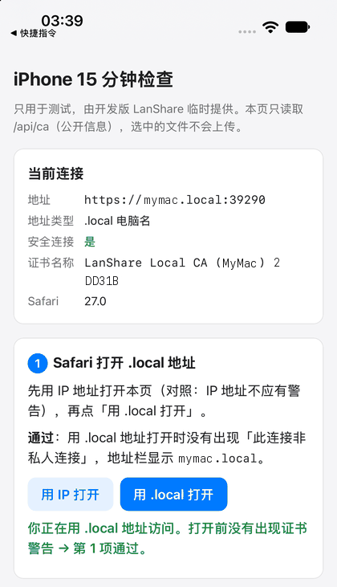
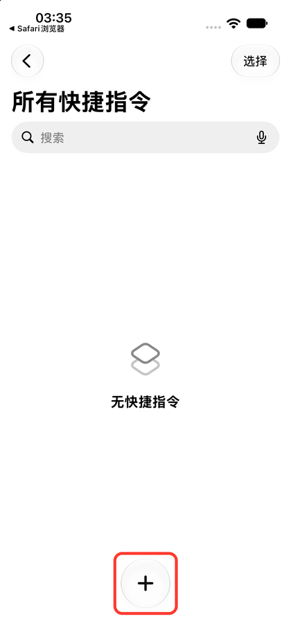
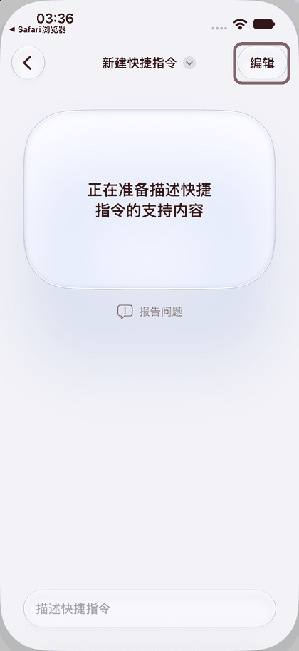
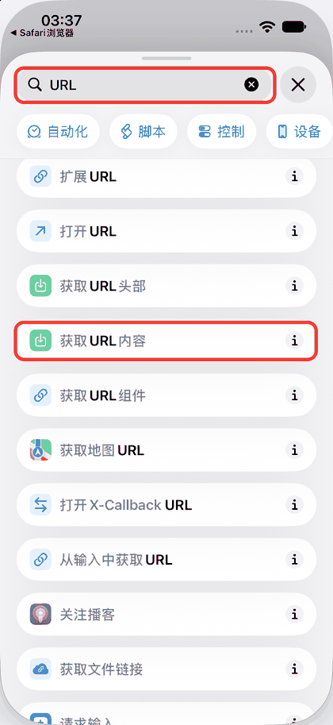
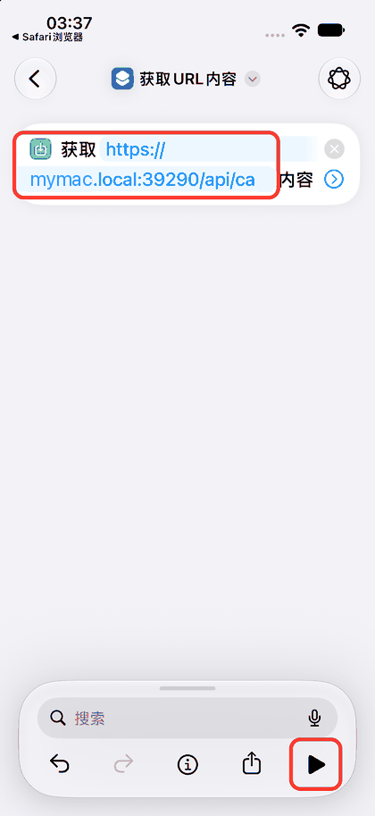
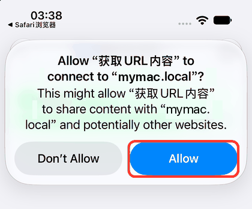
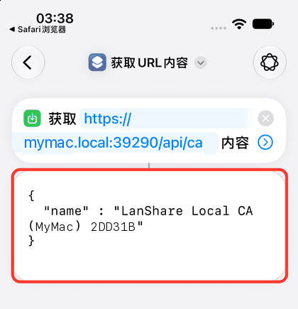
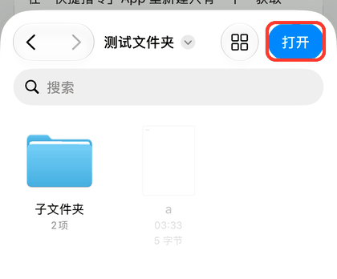
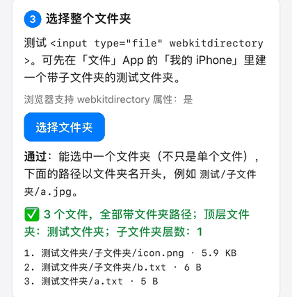

# The 15-minute iPhone check

One sitting with the real iPhone, with the LanShare certificate trusted. Each answer decides part of the plan (PLAN.md section 12, "15-minute iPhone check"):

| # | Check | Decides |
|---|---|---|
| 1 | Safari opens `https://mymac.local:39210` with no warning | The `.local` part of M9 |
| 2 | A Shortcut with one **获取 URL 内容** (Get Contents of URL) action reaches `/api/ca` over `.local` and over the IP | Whether the Shortcuts part of M9 is built |
| 3 | `<input type="file" webkitdirectory>` lets you pick a whole folder | Whether folder upload goes on the backlog |
| 4 | The share sheet behind **存储到相册** (Save to Photos) already offers **拷贝** (Copy) and **微信** (WeChat) | Whether a separate "copy image" button is needed |

A test page on the computer covers checks 1 and 3, gives you the two addresses for check 2, and reminds you of check 4. Chinese labels are the ones on a Chinese-language iPhone; the English in brackets is what an English-language iPhone shows or what the label means.

## How the page is served, and why

- The page lives in `scripts/iphone-check/`, not in `public/` (Vite copies `public/` into every build, release builds included).
- `scripts/iphone_check.sh` builds the web UI, copies the page into `dist/`, starts the **desktop app's debug build** (`cargo run`), and deletes the page from `dist/` when it exits. Debug builds read `dist/` from disk on every request. Release builds (`npm run tauri build`) first run `npm run build`, which empties `dist/`, and then embed it at compile time, so they never contain the page.
- Why the desktop debug build and not the headless runner: the iPhone trusts the certificate authority in the installed app's data folder (`~/Library/Application Support/com.lanshare.desktop/tls`), and the desktop app, debug or release, uses that folder. The test server therefore presents a certificate the iPhone already trusts, so checks 1 and 2 test the real setup, and the phone stays paired for check 4. The headless runner needs a data folder of its own: a new CA (Safari warns, which defeats checks 1 and 2, and the phone would need a second root certificate), or a copy of the CA's private key. Pointing it at the real folder would also overwrite your shared folder setting, because its `--shared` option is saved into `config.json`.
- Nothing about security changes: the page is static and public like the app shell (the pairing page), is served with the same Content Security Policy, and calls only `GET /api/ca`, which is already public. There is no new route, API or app code. The folder picker reads file names inside Safari; nothing is uploaded.
- The debug build uses your normal LanShare data, the same as `npm run tauri dev`.

`scripts/iphone_check.sh --headless` runs the same page on the headless runner with throwaway data in `.dev-data/iphone-check` (port 39290, its own CA). Use it only to work on the page; Safari warns there.

## Before you start (Mac, about 3 minutes)

1. Use a checkout that has `scripts/iphone_check.sh` (`main` once this is merged). Run `npm ci` first if `node_modules` is missing.
2. Quit LanShare: menu bar icon › **退出 LanShare** (Quit LanShare). The script refuses to start while the port is taken; otherwise the debug build would move to the next port and save it, and the address on your iPhone would change.
3. Run:

   ```bash
   scripts/iphone_check.sh
   ```

   The first run compiles the debug build, which takes a few minutes. The LanShare window opens as usual.
4. If macOS asks whether "lanshare" may accept incoming network connections, click **允许** (Allow). The firewall treats the debug build as a separate program.
5. The terminal prints two addresses, and the IP one is on the Mac clipboard.
6. On the iPhone, make sure the certificate is still trusted: **设置 › 通用 › 关于本机 › 证书信任设置** (Settings › General › About › Certificate Trust Settings), switch for "LanShare Local CA (Mac)" on.

## Check 1: `.local` in Safari (about 2 minutes)

1. Open the IP address in Safari on the iPhone: long-press the address bar › **粘贴并前往** (Paste and Go), which works if Universal Clipboard is on; otherwise type it, including `https://`.
   There should be no warning here. If even the IP address shows **此连接非私人连接** (This Connection Is Not Private), the certificate is not trusted: fix that first, otherwise check 1 tells you nothing.

   

2. Tap **用 .local 打开** (Open with .local).
3. **Pass**: the page opens with no warning, the address bar shows `mymac.local`, and the page says **你正在用 .local 地址访问** (You are using the .local address) in green.

   

   Record a failure exactly: a certificate warning (the `.local` name is the problem) or a page saying Safari cannot find the server (the name does not resolve on this network).

## Check 2: a one-action Shortcut (about 5 minutes)

The page lists both addresses under **2 快捷指令访问 /api/ca**; each **复制** (Copy) button puts one on the iPhone clipboard. Start with the `.local` one.

The screenshots come from a Simulator test run on port 39290 with a test certificate; your addresses end in `:39210` and the name is your certificate's.

1. Open **快捷指令** (Shortcuts) › **所有快捷指令** (All Shortcuts) and tap **+** at the bottom.

   

2. iOS 27 starts with **描述快捷指令** (Describe a shortcut). Tap **编辑** (Edit) at the top right to build it by hand. (Without this screen you land in the editor directly.)

   

3. In **搜索** (Search), type `URL` and tap **获取 URL 内容** (Get Contents of URL). Not **获取 URL 头部** (Get Headers of URL), the one above it.

   

4. Tap the light blue **URL** placeholder, paste the `.local` address (long-press › **粘贴** Paste), tap **✓**, then tap **▶** at the bottom right to run it.

   

5. The first run for each address asks for permission, something like **允许"获取 URL 内容"连接到"mymac.local"吗？** (Allow "Get Contents of URL" to connect to "mymac.local"?). Tap **允许** (Allow). If you tap **不允许** (Don't Allow) by mistake, delete the shortcut and make a new one.

   

6. **Pass**: a box under the action shows `"name" : "LanShare Local CA (Mac)"`, the same name the page shows under **证书名称** (Certificate name). A failure is an error alert instead; write down its text (for example that the certificate is invalid, or that the server cannot be reached).

   

7. Tap the blue address, replace it with the IP address (the second **复制** on the page), and run again. Allow again if asked, and record this result separately.

The Shortcut sends no cookie or token: `/api/ca` is public. Delete the test shortcut afterwards if you like (long-press › **删除** Delete).

## Check 3: pick a whole folder (about 3 minutes)

1. In **文件** (Files) › **我的 iPhone** (On My iPhone), make a test folder with a subfolder and a few files, or use any folder: nothing is uploaded.
2. Back on the page, tap **选择文件夹** (Choose folder). In folder mode, files are greyed out: go into the folder you want and tap **打开** (Open) at the top right.

   

3. **Pass**: a green ✅ line says how many files arrived and that all of them carry folder paths, and the list shows `webkitRelativePath` values starting with the folder name.

   

   A failure: the picker only lets you choose files, or the line is a red ❌ (files without folder paths). If there is time, also try a folder in iCloud Drive and note any difference. The iOS 27.0 Simulator passes this check; the real iPhone is what counts.

## Check 4: the share sheet behind 存储到相册 (about 2 minutes)

The page cannot test this one. The debug build is your normal LanShare with your normal pairing, so do it in the app:

1. Open LanShare on the iPhone (the Home Screen icon) and the conversation with this computer. If it has no photo yet, send one first.
2. Under a photo message, tap **存储到相册** (Save to Photos) › **打开分享** (Open share).
3. In the system share sheet, look for **拷贝** (Copy) in the list of actions and **微信** (WeChat) in the row of apps (swipe the row, and check **更多** (More) at its end).

**Pass**: both are there, so no separate "copy image" button is needed. Record which ones you saw.

## Finish

1. Press Ctrl+C in the terminal, or use menu bar icon › **退出 LanShare**. The script deletes the page from `dist/`.
2. Start the installed LanShare again.
3. Optional: delete the test shortcut and the test folder.

## Recording the results

Fill in this table, in the same format as PLAN.md 4.1.1, with ✅ / ⚠️ / ❌ and a short note (error text, file count, what the share sheet offered). It goes into PLAN.md section 4 as "15-minute iPhone check (date, iPhone model · iOS version)".

| Check | Result |
|---|---|
| Safari opens `https://mymac.local:39210` with the certificate trusted | |
| Shortcut, **获取 URL 内容** (Get Contents of URL) on `/api/ca` over `.local` | |
| Shortcut, **获取 URL 内容** (Get Contents of URL) on `/api/ca` over the IP | |
| `<input type="file" webkitdirectory>` picks a whole folder (file count, paths) | |
| Share sheet behind **存储到相册** (Save to Photos): **拷贝** (Copy) / **微信** (WeChat) | |

## Troubleshooting

- **The script says the port is in use**: LanShare (or an earlier check run) is still running. Quit it from the menu bar.
- **The IP address shows a warning too**: the iPhone does not trust this certificate. Check Certificate Trust Settings; the page's **证书名称** (Certificate name) row shows which certificate the server uses.
- **`.local` cannot be found**: put both devices on the same Wi-Fi, turn off any VPN on the iPhone, and note it if you are on a guest network or one that blocks multicast. Record the failure either way: it is an answer.
- **证书名称 shows 读取失败** (could not read): LanShare is paused; turn off **暂停共享** (Pause sharing) in the menu bar.
